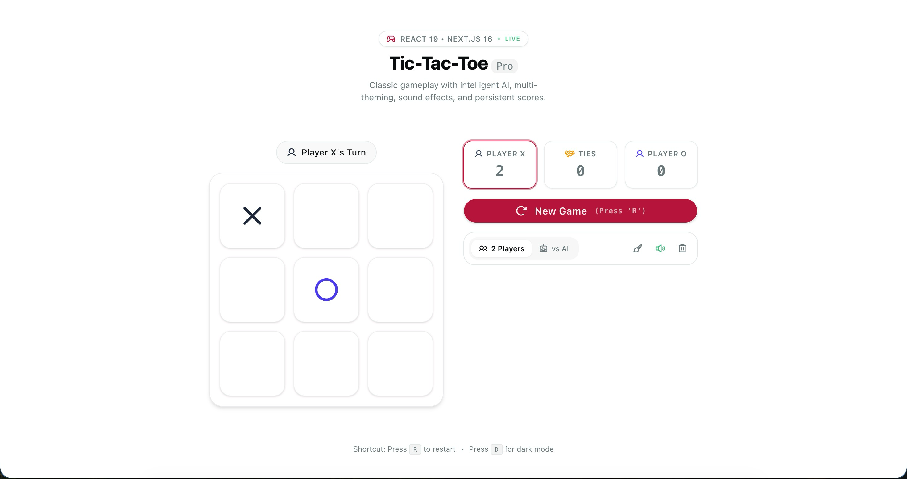
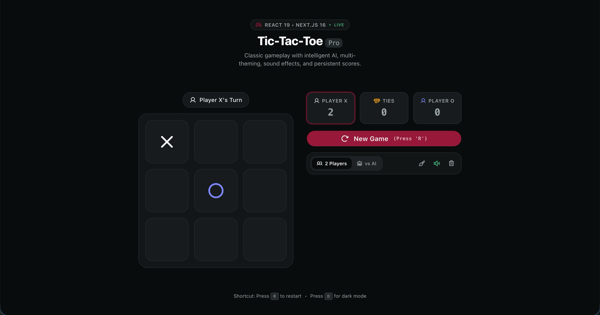
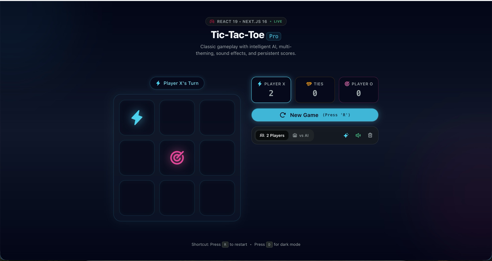

# 🎮 Tic-Tac-Toe Pro (React 19 & Next.js 16)

[](https://tic-tac-toe-paz.vercel.app)
[](https://nextjs.org)
[](https://react.dev)
[](https://tailwindcss.com)

> **Live Production App:** [https://tic-tac-toe-paz.vercel.app](https://tic-tac-toe-paz.vercel.app)  
> **Submission Channel:** Developer Assessment for Semprove Inc / student marketplace via `apply.capm.us` (Option: *1) Tic-Tac-Toe*).  
> **Development Methodology:** Formally architected and implemented under the [Enterprise AI SDLC Blueprint](docs/ai-sdlc/README.md).

---

## 📸 Application Screenshots

| ⚡ Cyberpunk Neon (2-Column Desktop Layout) | 🏆 Victory Glow & Confetti FX | 🎨 Clean Minimalist Theme |
| :---: | :---: | :---: |
|  |  |  |

---

## 📖 About the Application

**Tic-Tac-Toe Pro** is a modern, high-performance web application designed to showcase enterprise-grade React 19 and Next.js 16 App Router engineering. Built in response to the technical challenge brief in [`docs/test-1.md`](docs/test-1.md), it elevates the classic 3×3 game with an unbeatable AI opponent, dynamic theme switching, browser-native audio synthesis, celebration particle effects, and an ergonomic two-column responsive layout.

---

## 🌟 Key Features & Architectural Highlights

### 1. Core Game Mechanics (100% Assessment Pass Criteria)
- **Interactive 3×3 Grid:** Responsive board with fluid icon entrance transitions and cell-click handling.
- **Deterministic Win & Draw Detection:** Evaluates all 8 winning axes (3 rows, 3 columns, 2 diagonals) in real-time, highlighting the winning combination with glowing animations.
- **Instant Restart:** One-click "New Game" button with hotkey support (<kbd>R</kbd>) that resets the board without clearing historical match scores.

### 2. Personality, Theming & UX Differentiators
- **Dual Thematic Engine:**
  - ⚡ **Cyberpunk Neon:** High-contrast dark aesthetic featuring neon cyan and magenta Phosphor icons (`Lightning` and `Target`), glowing borders, and retro synth sound effects.
  - 🎨 **Clean Minimalist:** Subtle slate aesthetics, crisp typography, clean geometry (`X` and `Circle`), and modern tap feedback.
- **Unbeatable Minimax AI Mode:**
  - Switch between **2-Player Local (Pass & Play)** and **vs AI (Unbeatable)**.
  - Powered by a mathematically optimal Minimax algorithm with depth-weighting.
  - Includes an intentional 320ms "thinking" state indicator for a natural game pacing experience.
- **Synthesized Web Audio API FX:**
  - 100% browser-native sound generation (`AudioContext`) with zero external audio assets or network requests.
  - Distinct pleasant sound effects for cell clicks, winning arpeggios, and draw intervals.
- **Canvas Confetti Celebration:**
  - Zero-dependency, 60fps canvas particle physics explosion on game victory that automatically unmounts from the DOM.
- **Persistent Scoreboard with Zero Hydration Mismatches:**
  - Tracks Player X wins, Player O / AI wins, and Ties across browser sessions.
  - Employs React 19's `useSyncExternalStore` to synchronize with `localStorage` without triggering cascading re-renders or SSR hydration mismatch warnings (Next.js errors #418/#423).

### 3. Ergonomic 2-Column Responsive Layout
- **Desktop & Tablet (`md:` breakpoint and above):**  
  Features a balanced two-column dashboard: the 3×3 game arena sits on the left, while the live scoreboard and control center (New Game, mode switcher, theme toggle, mute sound, reset scores) sit on the right.
- **Mobile (`< md`):**  
  Gracefully stacks into an intuitive mobile view with touch-friendly tap targets (minimum 44×44px).

---

## ⌨️ Game Controls & Keyboard Shortcuts

| Shortcut | Action | Description |
| :---: | :--- | :--- |
| <kbd>R</kbd> | **New Game / Restart** | Instantly resets the active 3×3 board |
| <kbd>D</kbd> | **Toggle Dark / Light Mode** | Switches color palette via `next-themes` |
| <kbd>Tab</kbd> | **Cell Navigation** | Moves focus sequentially through board cells `0..8` |
| <kbd>Enter</kbd> / <kbd>Space</kbd> | **Mark Cell** | Places player mark on the currently focused cell |

---

## 🏗️ Technical Stack & Dependencies

| Layer | Technology | Version | Purpose |
| :--- | :--- | :--- | :--- |
| **Framework** | Next.js (App Router) | `16.4.6` | Static page pre-rendering, edge routing |
| **UI Library** | React | `19.3.1` | Concurrent rendering, `useSyncExternalStore` |
| **Styling** | Tailwind CSS (PostCSS) | `v4` | Modern CSS cascade layers (`@theme`), CSS variables |
| **Icons** | Phosphor Icons | `^2.1.10` | Thematic vector icons (`@phosphor-icons/react`) |
| **Primitives** | shadcn/ui + Base UI | `^1.9.0` | Accessible unstyled button primitives |
| **Deployment** | Vercel Platform | Production | Automated GitHub CI/CD, Edge CDN |

---

## 📂 AI SDLC Documentation Index

This project was built following a formal 6-phase software development lifecycle documented in [`docs/ai-sdlc/`](docs/ai-sdlc/):

1. 📋 [**Phase 1: Spec & Requirements**](docs/ai-sdlc/01-spec-and-requirements.md) – Deconstruction of `docs/test-1.md` into a formal PRD and Gherkin acceptance criteria.
2. 🎨 [**Phase 2: UI/UX & Design System**](docs/ai-sdlc/02-ui-ux-design-system.md) – Tailwind v4 token architecture, dual themes, and Finite State Machine.
3. ⚡ [**Phase 3: Code Generation & Guardrails**](docs/ai-sdlc/03-context-aware-code-generation.md) – Anti-hallucination guardrails and atomic prompting sequences.
4. 🧪 [**Phase 4: QA & Verification**](docs/ai-sdlc/04-qa-testing-and-verification.md) – Test matrices, Minimax proofs, and pre-commit quality gates.
5. 🚀 [**Phase 5: Deployment & CI/CD**](docs/ai-sdlc/05-deployment-and-ci-cd.md) – Vercel production deployment and release verification.
6. 📦 [**Phase 6: Submission Engineering**](docs/ai-sdlc/06-submission-and-reviewer-artifacts.md) – Loom video demo script and reviewer pitch.

---

## 🛠️ Local Development & Scripts

```bash
# Clone the repository
git clone https://github.com/ryfazrin/tic-tac-toe-paz.git
cd tic-tac-toe-paz

# Install dependencies
npm install

# Start local development server
npm run dev

# Run TypeScript strict type verification
npm run typecheck

# Run ESLint & React 19 core web vitals check
npm run lint

# Build production bundle
npm run build
```

---

## 🚀 Live Production Links

- **Production URL:** [https://tic-tac-toe-paz.vercel.app](https://tic-tac-toe-paz.vercel.app)
- **GitHub Repository:** [https://github.com/ryfazrin/tic-tac-toe-paz](https://github.com/ryfazrin/tic-tac-toe-paz)
- **Vercel Project Dashboard:** [vercel.com/ryan-pazrins-projects/tic-tac-toe-paz](https://vercel.com/ryan-pazrins-projects/tic-tac-toe-paz)
