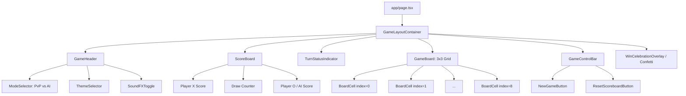
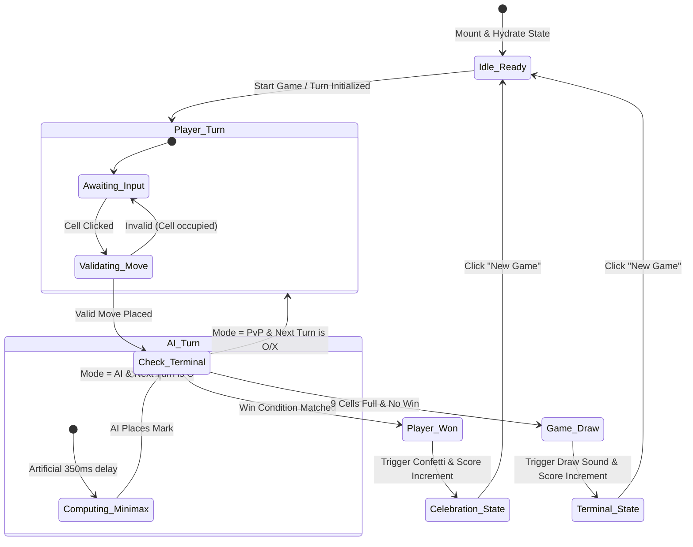

# Phase 2: UI/UX Architecture & Design System Synthesis

> **Goal:** Leverage AI prototyping tools (v0.dev, Claude Artifacts) to design a modular, accessible, and responsive design system tailored for Tailwind CSS v4, Base UI, and Phosphor Icons before writing production code.

---

## 1. Design Token & Theming Architecture

The project utilizes Tailwind CSS v4 (`@tailwindcss/postcss`) which uses native CSS variables and modern cascade layers instead of the legacy `tailwind.config.js`.

### Thematic Specifications

```
                       ┌───────────────────────────────────────────────┐
                       │               THEME SWITCHER                  │
                       └──────────────┬─────────────────┬──────────────┘
                                      │                 │
                ┌─────────────────────▼───┐         ┌───▼─────────────────────┐
                │     CYBERPUNK NEON      │         │   CLEAN MODERN MINIMAL  │
                ├─────────────────────────┤         ├─────────────────────────┤
                │ Background: Deep Slate  │         │ Background: Neutral Off-│
                │ Primary X: Neon Cyan    │         │             white / Dark│
                │ Primary O: Neon Magenta │         │ Primary X: Crisp Slate  │
                │ Borders: Glowing 1px    │         │ Primary O: Indigo Accent│
                │ Fonts: Monospace/Tech   │         │ Borders: Subtle hairline│
                │ Audio: Retro Synth Bleep│         │ Audio: Clean Pop/Click  │
                └─────────────────────────┘         └─────────────────────────┘
```

#### Theme Token Mappings (`globals.css` layer variables)

```css
@theme {
  --color-board-bg: var(--board-bg);
  --color-cell-bg: var(--cell-bg);
  --color-cell-hover: var(--cell-hover);
  --color-player-x: var(--player-x);
  --color-player-o: var(--player-o);
  --color-win-highlight: var(--win-highlight);
}

/* Cyberpunk Mode Overrides */
[data-theme='cyberpunk'] {
  --board-bg: #090d16;
  --cell-bg: rgba(15, 23, 42, 0.7);
  --cell-hover: rgba(30, 41, 59, 0.9);
  --player-x: #06b6d4; /* Cyan neon */
  --player-o: #ec4899; /* Pink neon */
  --win-highlight: #10b981; /* Emerald neon pulse */
}

/* Minimalist Mode Overrides */
[data-theme='minimalist'] {
  --board-bg: #ffffff;
  --cell-bg: #f8fafc;
  --cell-hover: #f1f5f9;
  --player-x: #0f172a; /* Slate 900 */
  --player-o: #4f46e5; /* Indigo 600 */
  --win-highlight: #fef08a; /* Soft Amber */
}
```

---

## 2. AI Rapid Prototyping Prompts (v0.dev / Claude Artifacts)

Use these precise prompts to generate initial visual layouts and interaction models.

### Prompt 2.1: v0.dev Component Generator
```markdown
Create a modern, responsive Tic-Tac-Toe game dashboard in React 19 and Next.js 16 with Tailwind CSS v4 and shadcn/ui.

Layout Structure:
1. Header:
   - Title with dynamic thematic badge ("Tic-Tac-Toe Pro").
   - Controls: Game Mode toggle (2-Player Local vs AI Minimax), Theme Selector (Cyberpunk vs Minimalist), and Sound toggle.
2. Main Section:
   - Scoreboard banner: Shows Player X wins, Ties, and Player O / AI wins with responsive badge styling.
   - Status Indicator: Shows whose turn it is with an animated avatar indicator.
   - 3x3 Game Board: Centered square aspect-ratio grid with 3x3 responsive cells (96px to 120px each).
   - Cell Styling: Subtle hover feedback, smooth icon scale-in animation when marked, and glowing border animation on the 3 winning cells.
3. Footer / Controls:
   - Prominent "New Game" button with a refresh icon.
   - "Reset Scores" secondary outline button.
   - Move counter and keyboard shortcut hint (e.g., Press 'R' to reset).

Accessibility & Requirements:
- Use semantic buttons for each grid cell with aria-label="Cell {row}, {col}".
- Ensure full mobile responsiveness and touch-friendly tap targets (minimum 44x44px).
```

---

## 3. Component Hierarchy & Atomic Design



---

## 4. Finite State Machine (FSM) Specification

The game engine operates on a strictly defined state transition graph:



---

## 5. Accessibility (a11y) & Usability Standards

To ensure a high score in recruiter review:
1. **Full Keyboard Navigation**:
   - The 3×3 grid must support Arrow key navigation (Up/Down/Left/Right) or standard Tab sequencing across cells `[0..8]`.
   - `Enter` or `Space` marks the selected cell.
   - `R` key triggers game reset.
2. **Screen Reader Announcements**:
   - Use an `aria-live="polite"` container to announce turn changes: `"Player X's turn"` or `"Player O placed mark in center cell"`.
   - On terminal states: `"Player X won on row 1!"` or `"Game ended in a draw!"`.
3. **Color Contrast**:
   - Both themes must pass WCAG AA contrast (minimum 4.5:1 ratio for text and icons against cell background).
