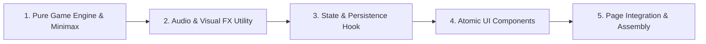

# Phase 3: Context-Aware Code Generation & Anti-Hallucination

> **Goal:** Guide AI coding tools (Cursor Composer, Claude Code, Antigravity) through an atomic, context-grounded implementation sequence while enforcing strict guardrails against Next.js 16 and React 19 hallucinations.

---

## 1. Context Grounding & Anti-Hallucination Guardrails

### 1.1. The Reality of Modern Next.js 16 & React 19
LLMs trained on historical code frequently hallucinate outdated conventions. The rule file in the repository root (`AGENTS.md`) warns:

> *"This version has breaking changes — APIs, conventions, and file structure may all differ from your training data... Heed deprecation notices."*

#### Common Hallucinations vs. Modern Requirements

| Deprecated / Hallucinated Pattern | Modern Required Pattern (This Project) | Reason |
| :--- | :--- | :--- |
| `forwardRef((props, ref) => ...)` | Standard component props: `({ ref, ...props })` | React 19 natively treats `ref` as a standard prop; `forwardRef` is deprecated. |
| `tailwind.config.js` or `tailwind.config.ts` | CSS-first `@theme` block in `globals.css` | Tailwind CSS v4 dropped the JS config file in favor of `@theme` directives. |
| `@tailwind base; @tailwind components;` | `@import "tailwindcss";` | Tailwind v4 uses a single CSS import. |
| Pages router (`pages/index.tsx`) | App Router (`app/page.tsx`) with Client Directive | Next.js 16 App Router default; interactive state components require `'use client'`. |
| Unsafe direct `localStorage` access in render | `useEffect` hydration barrier or `useSyncExternalStore` | Prevents Next.js SSR hydration mismatch error #418 / #423. |

### 1.2. The Context Injection Rule (`.cursorrules` / `AGENTS.md`)
Always provide your AI coding agent with the following system instructions before generating code:

```markdown
# AI Context Rule: React 19 & Next.js 16 Project
1. STACK: Next.js 16.4.6 (App Router), React 19.3.1, Tailwind CSS v4, TypeScript 5.
2. REACT 19 CONVENTION: Do not use `React.forwardRef`. Accept `ref` as a normal prop.
3. TAILWIND V4 CONVENTION: Do not attempt to read or modify `tailwind.config.js`. Use CSS variables under `@theme` in `app/globals.css`.
4. NEXT.JS SSR GUARD: Interactive game components must declare `'use client'`. Any access to `window` or `localStorage` must be deferred until client-side mount (`useEffect` or `isMounted` state) to prevent SSR hydration mismatches.
5. TYPESCRIPT STRICTNESS: No `any`. Explicitly type all state, hooks, and handler signatures.
```

---

## 2. The "Inspect First, Generate Second" Protocol

Never ask an AI to *"build the whole game"* in one giant prompt. Large monolytic prompts lead to dropped requirements, broken edge cases, and missing accessibility attributes.

Follow the **5-Step Atomic Prompt Chain**:



---

## 3. Atomic Prompting Sequence & Code Contracts

### Step 3.1: Pure Game Engine & Unbeatable Minimax
**Tool:** Cursor Composer / Claude Code  
**Target File:** `lib/game-engine.ts`

```markdown
Prompt:
Create `lib/game-engine.ts` with pure TypeScript functions for Tic-Tac-Toe:
1. Define types `PlayerMark = 'X' | 'O'`, `Board = (PlayerMark | null)[]`, and `WinResult = { winner: PlayerMark; line: [number, number, number] } | null`.
2. Implement `checkWin(board: Board): WinResult`.
   - The 8 winning combinations are: [0,1,2], [3,4,5], [6,7,8], [0,3,6], [1,4,7], [2,5,8], [0,4,8], [2,4,6].
3. Implement `checkDraw(board: Board): boolean` (returns true if all 9 cells are non-null and `checkWin` is null).
4. Implement `getBestMove(board: Board, aiMark: PlayerMark): number` using the Minimax algorithm with depth weighting so the AI is mathematically unbeatable.
5. Export all functions cleanly. Pure logic only—no React hooks or DOM dependencies.
```

#### Minimax Reference Implementation Contract
```typescript
// lib/game-engine.ts (excerpt)
export function getBestMove(board: (string | null)[], aiMark: 'X' | 'O'): number {
  const humanMark = aiMark === 'X' ? 'O' : 'X';

  function minimax(currentBoard: (string | null)[], depth: number, isMaximizing: boolean): number {
    const win = checkWin(currentBoard);
    if (win?.winner === aiMark) return 10 - depth;
    if (win?.winner === humanMark) return depth - 10;
    if (checkDraw(currentBoard)) return 0;

    if (isMaximizing) {
      let maxEval = -Infinity;
      for (let i = 0; i < 9; i++) {
        if (!currentBoard[i]) {
          currentBoard[i] = aiMark;
          const evaluation = minimax(currentBoard, depth + 1, false);
          currentBoard[i] = null;
          maxEval = Math.max(maxEval, evaluation);
        }
      }
      return maxEval;
    } else {
      let minEval = Infinity;
      for (let i = 0; i < 9; i++) {
        if (!currentBoard[i]) {
          currentBoard[i] = humanMark;
          const evaluation = minimax(currentBoard, depth + 1, true);
          currentBoard[i] = null;
          minEval = Math.min(minEval, evaluation);
        }
      }
      return minEval;
    }
  }

  let bestScore = -Infinity;
  let move = -1;
  for (let i = 0; i < 9; i++) {
    if (!board[i]) {
      board[i] = aiMark;
      const score = minimax(board, 0, false);
      board[i] = null;
      if (score > bestScore) {
        bestScore = score;
        move = i;
      }
    }
  }
  return move;
}
```

---

### Step 3.2: Sound & Particle FX Utility
**Target File:** `lib/fx.ts`

```markdown
Prompt:
Create `lib/fx.ts` for browser-native audio and celebratory visual effects:
1. Use Web Audio API (`AudioContext`) to generate synthesized sound effects without external audio files:
   - `playClickSound()`: Short 600Hz sine blip (30ms).
   - `playWinSound()`: Melodic arpeggio (C5 -> E5 -> G5 -> C6).
   - `playDrawSound()`: Descending minor frequency slide.
2. Implement `triggerConfetti()`:
   - Check if window is defined.
   - Use dynamic import for `canvas-confetti` or a lightweight canvas particle explosion to celebrate wins.
3. Handle browser autoplay policies gracefully (resume AudioContext on user interaction).
```

---

### Step 3.3: React State & Persistence Hook
**Target File:** `hooks/use-tic-tac-toe.ts`

```markdown
Prompt:
Create a custom React 19 hook `useTicTacToe` in `hooks/use-tic-tac-toe.ts`:
1. Manage state:
   - `board`: `(PlayerMark | null)[]` initialized to 9 nulls.
   - `turn`: `'X' | 'O'`, default `'X'`.
   - `gameMode`: `'pvp' | 'ai-unbeatable'`, default `'pvp'`.
   - `scores`: `{ x: number, o: number, draws: number }`.
2. Persistence:
   - Persist scores to `localStorage` under key `ttt_scores_v1`.
   - Prevent SSR hydration mismatch: initialize score state safely, populate from `localStorage` inside a `useEffect` once `mounted` is true.
3. Actions:
   - `makeMove(index: number)`: Place mark, trigger click sound, evaluate win/draw. If in AI mode and game continues, trigger AI move after 300ms delay.
   - `resetGame()`: Clear board and win line, keep scores.
   - `resetScoreboard()`: Reset scores to 0 and update localStorage.
   - `toggleGameMode(mode: 'pvp' | 'ai-unbeatable')`: Switch mode and reset current board.
```

---

### Step 3.4: Atomic UI Components
**Target Directory:** `components/game/`

1. `BoardCell.tsx`: Accessible button cell with dynamic symbol rendering (Phosphor Icons `X`, `Circle`, `Lightning`, etc.), keyboard navigation, and winning-line animation.
2. `ScoreBoard.tsx`: Score badge cards showing Player X, Ties, and Player O scores.
3. `TurnIndicator.tsx`: Clear display of current turn with animated badge.
4. `GameControls.tsx`: "New Game" button, mode selector dropdown, and sound toggle.

---

### Step 3.5: Top-Level Integration (`app/page.tsx`)

```markdown
Prompt:
Assemble the complete Tic-Tac-Toe application in `app/page.tsx`:
1. Add `'use client'` at the top.
2. Consume `useTicTacToe` hook and `next-themes` for theme toggling.
3. Wrap layout in a centered responsive container with responsive padding.
4. Support keyboard shortcut `R` to quickly restart the game.
5. Render accessibility live status announcements using `<div aria-live="polite" className="sr-only">`.
```
