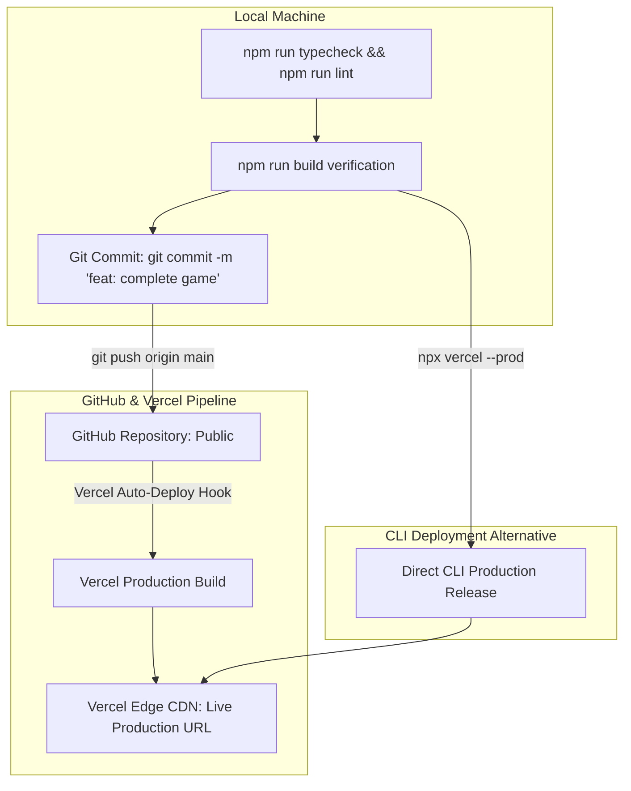

# Phase 5: Deployment & Release Engineering (Vercel)

> **Goal:** Deploy the application to a high-performance, public production environment on Vercel, ensuring zero build warnings, flawless SSR hydration, and verification against the submission requirements in `docs/test-1.md`.

---

## 1. Deployment Requirements from `docs/test-1.md`

The coding challenge explicitly emphasizes the following production constraints:
1. **Public Production URL Only**:
   - Must be the live production domain (e.g., `https://tic-tac-toe-paz.vercel.app`), **not** a temporary deployment preview URL containing a git hash or branch name (e.g., `https://tic-tac-toe-paz-git-main-xyz.vercel.app`).
2. **Public GitHub Repository**:
   - Repository must be publicly accessible with a clean git commit history reflecting the AI SDLC phases.
3. **Flawless Live Execution**:
   - The three core criteria (turns, win/draw notification, new game restart) must operate without client console errors.

---

## 2. Deployment Workflows



### Method A: GitHub to Vercel Automatic CI/CD (Recommended)
1. Initialize git remote and commit all verified files:
   ```bash
   git add .
   git commit -m "feat: complete game engine, UI theming, and test matrix"
   git push origin main
   ```
2. Navigate to [vercel.com/new](https://vercel.com/new) and import the GitHub repository.
3. Vercel automatically detects Next.js:
   - Framework Preset: `Next.js`
   - Build Command: `next build`
   - Output Directory: `.next`
4. Click **Deploy**.

### Method B: Vercel CLI Direct Deployment
```bash
# Link project and deploy preview
npx vercel

# Promote to production
npx vercel --prod
```

---

## 3. Common Deployment Traps & AI Troubleshooting

### 3.1. SSR Hydration Mismatch (`Error: Text content did not match`)
- **Root Cause**: `localStorage` scores or dynamic theme variables are read during the initial server-side render, causing the SSR HTML to differ from the initial client render.
- **AI Remedy Prompt**:
  ```markdown
  Fix this Next.js 16 SSR hydration mismatch error.
  Ensure any access to `window.localStorage` is deferred until after the component mounts using a `mounted` boolean flag in `useEffect`. Provide a fallback skeleton state during SSR.
  ```

### 3.2. Static Page Generation vs. Client Dynamic State
- **Root Cause**: Next.js 16 App Router attempts to statically prerender `app/page.tsx` during `next build`, but encounters dynamic browser APIs (`AudioContext`, `window.innerWidth`).
- **Fix**: Declare `'use client'` at the absolute top of the interactive entry point, and encapsulate all Web Audio / Confetti calls within guarded client event handlers:
  ```typescript
  if (typeof window !== 'undefined') {
    // Safe browser execution
  }
  ```

### 3.3. Tailwind CSS v4 PostCSS Build Failures
- **Root Cause**: Mixing legacy Tailwind v3 syntax (`@tailwind base;` or `tailwind.config.js`) with `@tailwindcss/postcss` v4.
- **Verification**: Ensure `app/globals.css` only uses `@import "tailwindcss";` and `@theme` definitions, and that `postcss.config.mjs` lists `@tailwindcss/postcss`.

---

## 4. Post-Deployment Verification Checklist

Before copying the URL to the submission form, run this verification protocol on the live URL:

- [ ] **URL Structure**: URL is clean and permanent (e.g., `https://[project-name].vercel.app`).
- [ ] **Console Cleanliness**: Open Chrome DevTools Console; verify zero red warnings, zero React key errors, and zero hydration errors.
- [ ] **Mobile Responsiveness**: Test on mobile screen view (375px width); board cells do not overflow; tap targets are easily pressable.
- [ ] **Core Web Vitals**: Run Google PageSpeed Insights or Lighthouse; ensure Performance, Accessibility, and Best Practices are > 90.
- [ ] **Scoreboard Persistence**: Win a round, refresh the page, and verify the scoreboard maintains the correct state.
