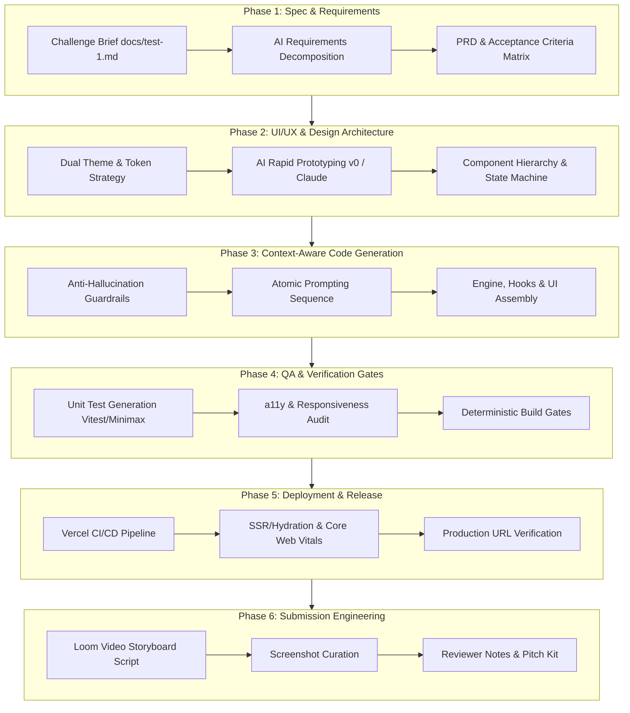

# Enterprise AI SDLC Blueprint: Tic-Tac-Toe Next.js Challenge

> **Assessment Context:** Technical Coding Challenge for Software Developer Role (Semprove Inc / student marketplace) via `apply.capm.us`.  
> **Key Guiding Principle:** *"AI tools are encouraged. Building well with AI is a skill we're looking for."*

---

## 1. Executive Summary

This repository outlines and executes an **End-to-End Spec-Driven AI Software Development Life Cycle (AI SDLC)**. Instead of using AI as an ad-hoc autocomplete tool, this methodology treats AI as a collaborative multi-agent software engineering partner across the entire project lifecycle—from requirements analysis to final submission and deployment verification.

### Core Philosophy
1. **Spec-Driven Engineering**: Never prompt for code without an explicit specification, architectural boundary, and test contract.
2. **Context Grounding & Anti-Hallucination**: Enforce project-level rules (`AGENTS.md`, `.cursorrules`, `tsconfig.json`) to eliminate version skew (specifically Next.js 16.4+, React 19.3+, and Tailwind CSS v4).
3. **Multi-Tool Orchestration (Best-of-Breed)**: Assign specific AI tools to their highest-leverage phases (e.g., v0/Claude for UI prototyping, Cursor/Claude Code with repo context for implementation, and frontier models for algorithmic verification and pitch drafting).
4. **Automated Quality Gates**: Mandate strict "Inspect First, Generate Second" protocols and pre-commit verification loops (`typecheck`, `lint`, `build`).

---

## 2. End-to-End AI SDLC Lifecycle Map

---

## 3. Multi-Tool AI Ecosystem & Role Matrix

| Phase | Primary AI Tool | Model / Engine | Role & Responsibility | Output Deliverables |
| :--- | :--- | :--- | :--- | :--- |
| **1. Spec & PRD** | Claude 3.5 Sonnet / ChatGPT | Frontier LLM | Requirement extraction, edge case taxonomy, PRD authoring | [01-spec-and-requirements.md](file:///Users/ryfazrin/Projects/javascript-projects/tic-tac-toe-paz/docs/ai-sdlc/01-spec-and-requirements.md) |
| **2. UI/UX Architecture** | v0.dev / Claude Artifacts | Claude 3.5 / GPT-4o | Wireframing, Tailwind v4 design tokens, theme switching UI | [02-ui-ux-design-system.md](file:///Users/ryfazrin/Projects/javascript-projects/tic-tac-toe-paz/docs/ai-sdlc/02-ui-ux-design-system.md) |
| **3. Code Generation** | Cursor Composer / Claude Code / Antigravity | Claude 3.7 Sonnet / Gemini 2.5 Flash | Context-grounded atomic code writing, refactoring, hook creation | [03-context-aware-code-generation.md](file:///Users/ryfazrin/Projects/javascript-projects/tic-tac-toe-paz/docs/ai-sdlc/03-context-aware-code-generation.md) |
| **4. QA & Verification** | AI CLI / Vitest / GitHub Copilot | Frontier LLM | Minimax optimality proofs, unit tests, a11y ARIA verification | [04-qa-testing-and-verification.md](file:///Users/ryfazrin/Projects/javascript-projects/tic-tac-toe-paz/docs/ai-sdlc/04-qa-testing-and-verification.md) |
| **5. Deployment** | Vercel CLI + AI Troubleshooting | Frontier LLM | Next.js 16 build optimization, hydration error resolution | [05-deployment-and-ci-cd.md](file:///Users/ryfazrin/Projects/javascript-projects/tic-tac-toe-paz/docs/ai-sdlc/05-deployment-and-ci-cd.md) |
| **6. Submission Prep** | Frontier LLM / Loom Scripting | Claude 3.5 Sonnet | Video demo storyboard, screenshot curation, reviewer memo | [06-submission-and-reviewer-artifacts.md](file:///Users/ryfazrin/Projects/javascript-projects/tic-tac-toe-paz/docs/ai-sdlc/06-submission-and-reviewer-artifacts.md) |

---

## 4. Documentation Modules Index

Explore each stage of the AI SDLC in its dedicated module:

1. 📋 [**Phase 1: Specification & Requirements Engineering**](file:///Users/ryfazrin/Projects/javascript-projects/tic-tac-toe-paz/docs/ai-sdlc/01-spec-and-requirements.md)  
   Deconstruction of the assessment brief, functional vs. non-functional requirements matrix, feature tiering (Core MVP vs. Differentiators), and automated PRD generation prompts.

2. 🎨 [**Phase 2: UI/UX Architecture & Design System Synthesis**](file:///Users/ryfazrin/Projects/javascript-projects/tic-tac-toe-paz/docs/ai-sdlc/02-ui-ux-design-system.md)  
   Tailwind CSS v4 & Base UI design system tokens, Cyberpunk Neon vs. Clean Minimalist themes, component hierarchy, and the deterministic finite state machine (FSM).

3. ⚡ [**Phase 3: Context-Aware Code Generation & Anti-Hallucination**](file:///Users/ryfazrin/Projects/javascript-projects/tic-tac-toe-paz/docs/ai-sdlc/03-context-aware-code-generation.md)  
   Context grounding for Next.js 16 and React 19, `.cursorrules` / `AGENTS.md` configuration, and the step-by-step atomic prompt chain for implementation.

4. 🧪 [**Phase 4: AI-Assisted QA, Testing & Quality Gates**](file:///Users/ryfazrin/Projects/javascript-projects/tic-tac-toe-paz/docs/ai-sdlc/04-qa-testing-and-verification.md)  
   Automated test generation (Vitest), Minimax game theory validation, WCAG AA accessibility audits, and pre-commit verification scripts.

5. 🚀 [**Phase 5: Deployment & Release Engineering (Vercel)**](file:///Users/ryfazrin/Projects/javascript-projects/tic-tac-toe-paz/docs/ai-sdlc/05-deployment-and-ci-cd.md)  
   Zero-downtime Vercel production deployment, Next.js 16 App Router SSR/SSG caching, hydration mismatch prevention with localStorage, and release checks.

6. 📦 [**Phase 6: Submission Engineering & Reviewer Artifacts**](file:///Users/ryfazrin/Projects/javascript-projects/tic-tac-toe-paz/docs/ai-sdlc/06-submission-and-reviewer-artifacts.md)  
   Submission checklist for `apply.capm.us`, complete 2-minute Loom demo video storyboard, screenshot staging guide, and comprehensive "Notes for the Reviewer".
