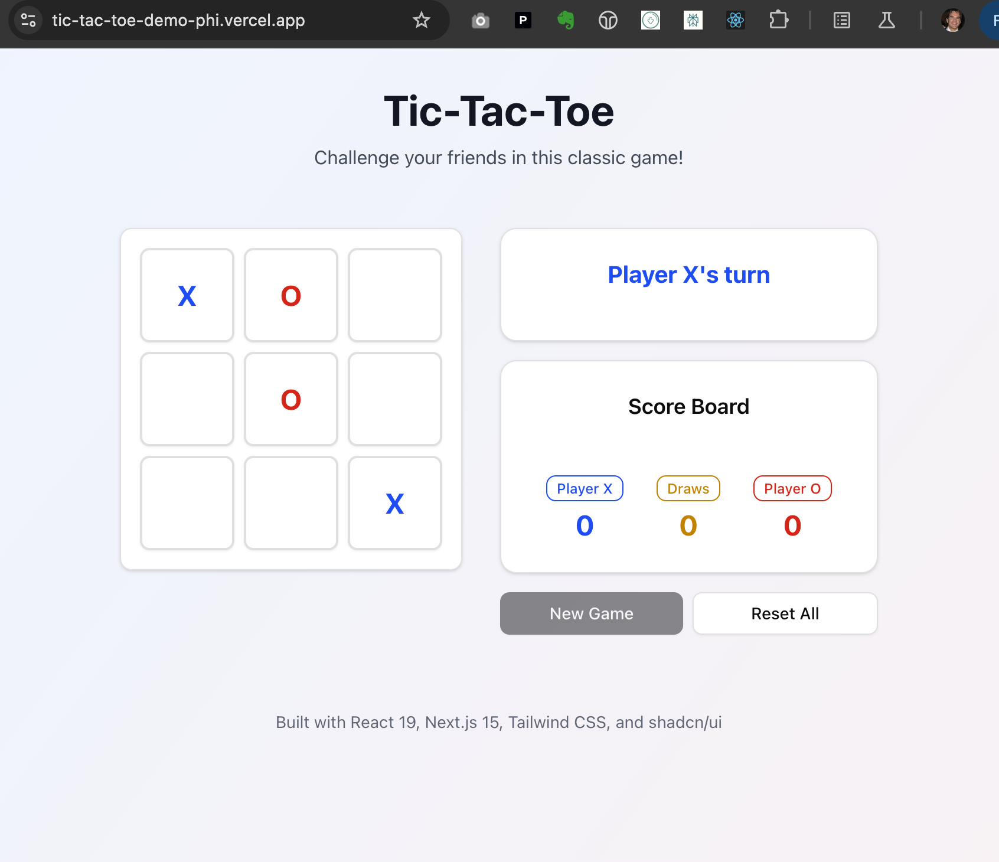
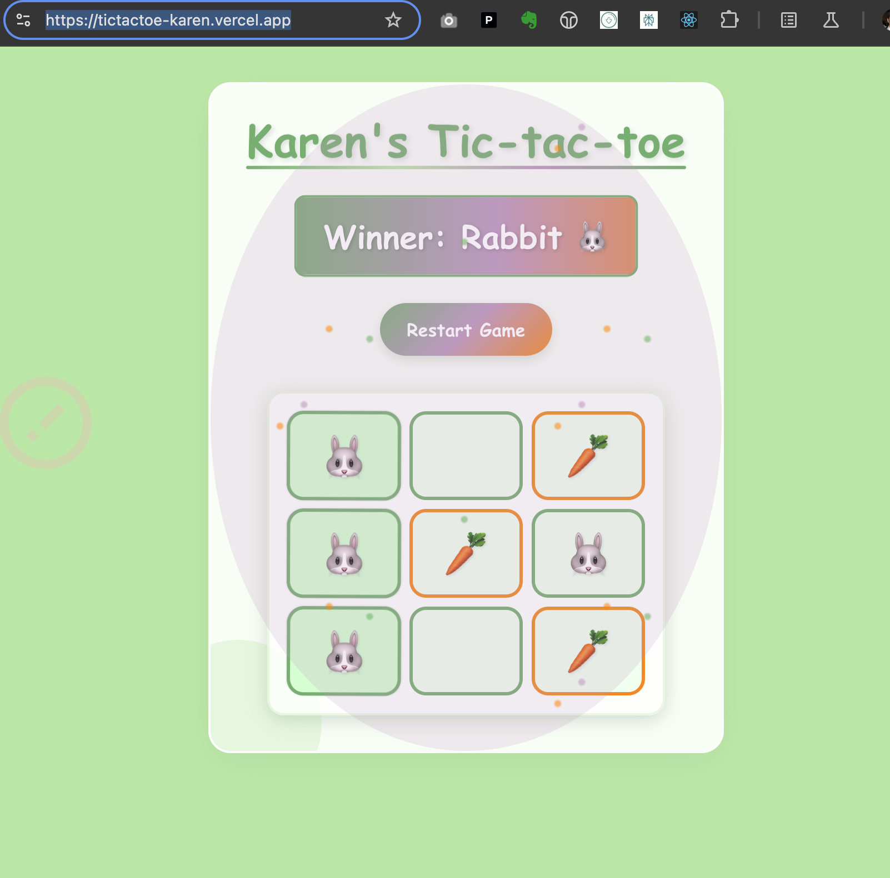
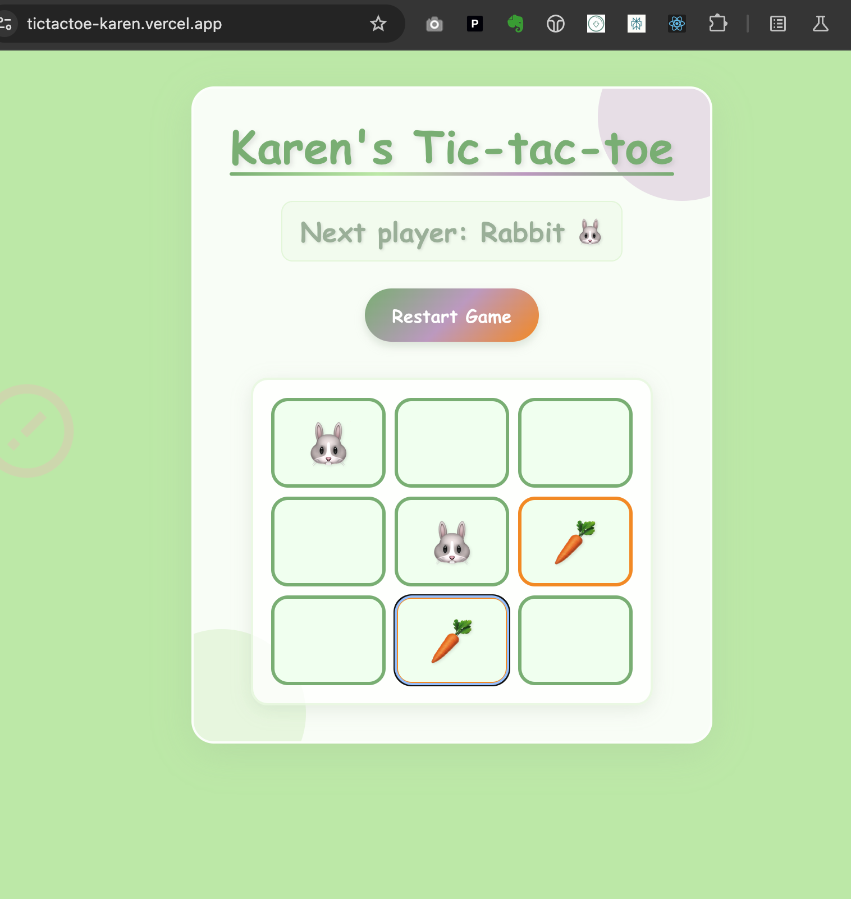

# test-1

<aside>
🤖

**AI tools are encouraged.** Use Claude, Cursor, ChatGPT, v0, or any AI coding tool you like. Building well with AI is a skill we're looking for.

</aside>

## Instructions

I’m super excited to invite you to apply for our Software Developer role! 

Submit your completed project here 👉 [https://apply.capm.us](https://apply.capm.us/)

Let's keep things fun—I have a practical coding challenge to showcase your React and Next.js skills.

### **🎮 Your Mission: Build a Tic-Tac-Toe Game!**

- 🎯 **Stack:** React + Next.js
- 🚀 **Deployment:** Show it off on Vercel
- 📺 **Instructions:** Check out the demo video below for all the details!

### ✅ What Counts as Done

You pass if these three things work on your live site:

1. Two players take turns placing their marks on a 3×3 board. Classic X and O is fine, or use your own icons, emoji, or GIFs.
2. The game shows who won, or that it's a draw.
3. A **New Game** button starts over.

That's it. A simple game passes, but **we love style and personality**. Past candidates have swapped X and O for cool icons and GIFs and added their own themes, so make it yours and have fun with it. Bonus (optional): a score board that counts wins and draws, like the example below.

Submit your awesome creation here 👉 [https://apply.capm.us](https://apply.capm.us/)

Looking forward to seeing your great work! Let's get started! 

# Demonstration Video

[https://www.loom.com/share/5c1fc7dfa1314619ad04265c7f5c5952?sid=8c902b64-3f02-4a84-9ffb-6e7faa7f2d25](https://www.loom.com/share/5c1fc7dfa1314619ad04265c7f5c5952?sid=8c902b64-3f02-4a84-9ffb-6e7faa7f2d25)

# Submission

In the form, choose **1) Tic-Tac-Toe** under "Which test are you submitting?". The form asks for:

1. **Live app URL** (required) – your public Vercel production URL, not a preview URL.
2. **GitHub repo URL** (required) – make sure the repository is public.
3. **Screenshots** (required) – upload screenshots of your game.
4. **Demo video** (optional) – upload a screen recording, or paste a Loom, YouTube, or Vimeo link set to public or unlisted.
5. **Notes for the reviewer** (optional) – anything we should know.

Submit your response at this form:  [https://apply.capm.us](https://apply.capm.us/) 

# Some Useful Resources

## Prompts

Example prompts you can give your AI coding tool:

- create a react 19 and next.js application called Tic-Tac-Toe and use tailwind css and shadcn ui
- deploy on vercel
- fix this

## Commands

```bash
npx vercel

npm run build

vercel --prod

git add .
git status
git commit -m "initial commit"
```

# Example Successful Applications

https://tic-tac-toe-demo-phi.vercel.app/



[https://tictactoe-karen.vercel.app/](https://tictactoe-karen.vercel.app/)





# Tips

- Be sure to submit your public app URL, not your private preview URL.

[How to find your public app URL on Vercel (1)](https://app.notion.com/p/How-to-find-your-public-app-URL-on-Vercel-1-422aba4cb92680399fa2eb61dedcd343?pvs=21)

- Please include screenshots of your app on the submission form.
- Including a demonstration screen recording video would be useful.

# Kalibrr Job Post

[https://www.kalibrr.com/c/semprove-inc/jobs/256541/react-next-js-developer-wanted-join-our-thriving-student-marketplace](https://www.kalibrr.com/c/semprove-inc/jobs/256541/react-next-js-developer-wanted-join-our-thriving-student-marketplace?ref=recruiter_job_card_clipboard_2030609)

### Project Page

[https://tictactoe.capm.us](https://tictactoe.capm.us/)